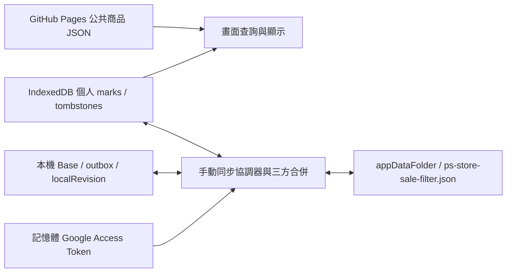

# Google Drive 同步模組重用分析

審查日期：2026-10-20（Asia/Taipei）。目標專案：`ps-store-sale-filter`。

## 1. 結論

**建議以 PS Game Base 作為 Drive 傳輸及衝突處理介面的主要來源，搭配 EDF 較新的 OAuth 模組及專案 JSON 包裝。兩個專案都不能直接提供新需求要求的完整同步引擎。**

可直接複製的基礎是 OAuth Token Flow、appDataFolder JSON 存取及版本化外層包裝；其中 Drive 存取必須選 PS Game Base 的嚴格 ETag 版本。逐筆／全部選擇本機或雲端的介面可改寫後重用。

尚缺：持久化的 Base、真正的三方合併、符合稀疏標記的 Tombstone、同步中修改的快照／待確認操作管理，以及 IndexedDB 原子套用流程。這些是新需求的核心，不能以現有「合併」按鈕或 Drive `version` 取代。

本階段僅審查與整理規格。未修改兩個來源 Repo、未建立正式網站、未實作 IndexedDB、未執行 Google OAuth 或真實 Drive 讀寫、未建立 Google Cloud 專案、未安裝依賴套件。

## 2. 審查版本與證據層級

| Repo | 本次審查的遠端 main commit | 本機狀態與取證方式 |
|---|---|---|
| [edfwb2-checklist](https://github.com/promise82114/edfwb2-checklist) | `4e803370784cabfc4050ab096fac9c6b5be83ccd` | 本機 HEAD 為 `0ef50e4`，落後遠端 5 個 commit；從已存在的 Git object 讀出遠端 commit 快照，沒有 pull 或修改來源 |
| [ps-game-base](https://github.com/promise82114/ps-game-base) | `9ab49834adfc17252c2f4c28ba910d77ab3fc9fd` | 本機 HEAD 與本次查得遠端相同；以該 commit 快照審查 |

兩個來源工作目錄在開始時均無未提交變更。下方連結固定到上述 commit，避免日後 main 移動造成證據混淆。來源快照與臨時探測只存於目前 POC Repo 忽略追蹤的 `.local/google-drive-audit/`。

本文使用三種標示：

- **程式碼已實作**：已閱讀實際實作及呼叫端，沒有只採用 README 宣稱。
- **本次測試已驗證**：只限本機、合成資料、VM／mock Drive 的重跑結果；不代表真實 Google 或瀏覽器驗收。
- **尚未確認**：真實 OAuth、Google Cloud 設定、Drive 跨裝置條件寫入、部署版行為等，本次未操作。

## 3. 實際模組與主要函式

### 3.1 EDF

| 證據 | 實際路徑／函式 | 已確認責任 |
|---|---|---|
| [E1](https://github.com/promise82114/edfwb2-checklist/blob/4e803370784cabfc4050ab096fac9c6b5be83ccd/dist/shared/google-auth.js#L7-L54) | `dist/shared/google-auth.js`：`loadGIS()`、`GoogleAuth.prepare/connect/token/invalidate/disconnect`、`connected`、`info` | 載入 GIS、popup、scope 驗證、記憶體 Token、到期／401 原因與重新選帳號控制 |
| [E2](https://github.com/promise82114/edfwb2-checklist/blob/4e803370784cabfc4050ab096fac9c6b5be83ccd/dist/shared/drive-appdata.js#L5-L56) | `dist/shared/drive-appdata.js`：`DriveAppData.request/json/find/metadata/read/write` | v3 列檔／下載／建立／更新，版本比較；ETag 來自下載標頭，缺少時仍允許更新 |
| [E3](https://github.com/promise82114/edfwb2-checklist/blob/4e803370784cabfc4050ab096fac9c6b5be83ccd/dist/shared/progress-envelope.js#L4-L7) | `dist/shared/progress-envelope.js`：`pack(projectId,data)`、`unpack(raw,projectId,validate)` | 外層 `schemaVersion=1`、projectId、更新時間驗證，內容驗證委派給 adapter |
| [E4](https://github.com/promise82114/edfwb2-checklist/blob/4e803370784cabfc4050ab096fac9c6b5be83ccd/dist/cloud-config.js#L1-L6) | `dist/cloud-config.js`：`SIDE_PROJECT_CLOUD_CONFIG` | 公開 Client ID、`projectId=edfwb2-checklist`、`fileName=edfwb2-checklist.json` |
| [E5](https://github.com/promise82114/edfwb2-checklist/blob/4e803370784cabfc4050ab096fac9c6b5be83ccd/dist/cloud-sync.js#L35-L105) | `dist/cloud-sync.js`：`read/sync/schedule/checkSession/restore`、`fingerprint/dirty` | 授權後自動同步；5 秒 debounce、每分鐘／online／回前景檢查；讀回驗證與衝突重試，合計最多 3 次嘗試 |
| [E6](https://github.com/promise82114/edfwb2-checklist/blob/4e803370784cabfc4050ab096fac9c6b5be83ccd/dist/app.js#L375-L398) | `dist/app.js`：`EDF_CHECKLIST_STORAGE.get/validate/reconcile/apply/export` | 遊戲資料 adapter；`reconcile` 依每筆時間合併，套用前保留快照 |
| [E7](https://github.com/promise82114/edfwb2-checklist/blob/4e803370784cabfc4050ab096fac9c6b5be83ccd/dist/app.js#L66-L123) | `dist/app.js`：`fresh/validate/mergeLatest/persist/saveSnapshot/change` | localStorage、本機進度格式、false 取消紀錄與每筆時間 |
| [E8](https://github.com/promise82114/edfwb2-checklist/blob/4e803370784cabfc4050ab096fac9c6b5be83ccd/verify-cloud.mjs#L1-L35) | `verify-cloud.mjs` | Playwright + mock GIS／Drive 的瀏覽器驗證腳本；不是 Google 真實讀寫測試 |

EDF 本機資料為 `app=edfwb2-collection`、`schema=1`、`catalogVersion`、毫秒 `updatedAt`，以及 `entries/favorites/content/missionNotes`。各項保存 `{owned|favorite|enabled, updatedAt}`；筆記保存 `{text,updatedAt}`。雲端再包為 `{schemaVersion,updatedAt,projectId,data}`。

### 3.2 PS Game Base

| 證據 | 實際路徑／函式 | 已確認責任 |
|---|---|---|
| [P1](https://github.com/promise82114/ps-game-base/blob/9ab49834adfc17252c2f4c28ba910d77ab3fc9fd/dist/shared/google-auth.js#L7-L53) | `dist/shared/google-auth.js`：`loadGIS()`、`GoogleAuth.prepare/connect/token/invalidate/disconnect` | 相同 GIS Token Flow；比 EDF 少 `info`、失效原因與可選的選帳號參數 |
| [P2](https://github.com/promise82114/ps-game-base/blob/9ab49834adfc17252c2f4c28ba910d77ab3fc9fd/dist/shared/drive-appdata.js#L5-L63) | `dist/shared/drive-appdata.js`：`sameVersion()`、`DriveAppData.request/find/metadata/read/write` | 嚴格版本及 ETag 保護；缺少保護資訊時禁止覆寫 |
| [P3](https://github.com/promise82114/ps-game-base/blob/9ab49834adfc17252c2f4c28ba910d77ab3fc9fd/dist/sync.js#L9-L75) | `dist/sync.js`：`compareImport(current,incoming)`、`resolveImport(current,incoming,plan,options)` | 兩份資料比較；獨有資料合併、不同內容預設保留本機，依 choices 選來源 |
| [P4](https://github.com/promise82114/ps-game-base/blob/9ab49834adfc17252c2f4c28ba910d77ab3fc9fd/dist/app.js#L115-L176) | `dist/app.js`：`preview/updateImportEffect/saveRecovery`、`confirm-import` 事件 | 差異清單、逐筆／全選、預覽快照失效檢查、操作前備份、上傳後本機套用 |
| [P5](https://github.com/promise82114/ps-game-base/blob/9ab49834adfc17252c2f4c28ba910d77ab3fc9fd/dist/app.js#L222-L232) | `dist/app.js`：`cloudAction/renderCloud`、cloud 按鈕事件 | Client ID、檔名 `ps-game-base.json`、手動下載／比較上傳、storage 事件停寫 |
| [P6](https://github.com/promise82114/ps-game-base/blob/9ab49834adfc17252c2f4c28ba910d77ab3fc9fd/dist/model.js#L36-L95) | `dist/model.js`：`emptyPersonal/personal/blankRecord/groupGames/workRecordFor` | 個人整理、作品分組與相容舊紀錄；不是新專案的 Product ID 模型 |
| [P7](https://github.com/promise82114/ps-game-base/blob/9ab49834adfc17252c2f4c28ba910d77ab3fc9fd/dist/app.js#L37-L43) | `dist/app.js`：`backup/download`；另見 `model.js:111–115` 的 `parseImport` | JSON 匯出／解析；Drive 上傳包含遊戲庫及個人整理的完整備份 |
| [P8](https://github.com/promise82114/ps-game-base/blob/9ab49834adfc17252c2f4c28ba910d77ab3fc9fd/tests/drive-appdata.test.mjs#L20-L99) | `tests/drive-appdata.test.mjs` | metadata ETag、版本競態、If-Match／412、缺少保護、首次建立及同名多檔測試 |

PS Game Base 本機 key 為 `ps-game-base.v1`，資料容器含 `library` 與 `personal`。個人格式為 `schemaVersion=1`、`kind=ps-game-base-personal`、`categories/records/works`；Drive 格式為 `kind=ps-game-base-backup`、`schemaVersion=1`，包含 library、personal、missingIds、exportedAt。

兩者的 schemaVersion 是各自格式版本；Drive `file.version` 是服務端檔案版本；ETag 是條件寫入的版本保護。這三種資訊都不是三方合併所需的 Base 內容。

## 4. 架構與能力比較

下表的「有」表示程式碼已實作；測試與真實服務證據另列第 5 節。

| 能力 | EDF | PS Game Base | 新專案判斷 |
|---|---|---|---|
| OAuth 選用、本機先行 | 有 | 有 | 沿用 |
| Token 保存 | private field 記憶體；到期 timer；重新整理失效 | 同左 | 不持久化 Token |
| scope | 僅 `drive.appdata` | 僅 `drive.appdata` | 沿用最小 scope |
| 自動同步 | 授權後預設開啟、debounce／輪詢／前景／online | 無；按鈕觸發 | EDF 排程不移植 |
| 真正三方合併 | 無；逐項時間 LWW | 無；Local／Incoming 兩方比較 | 必須新增 |
| 持久 Base | 無；`synced` 只是本頁 fingerprint | 無；preview 的 `base` 是操作前本機字串 | 必須新增共同祖先內容與版本綁定 |
| 不同商品自動合併 | 各 key 可按時間合併 | 單邊獨有可加入；兩邊都有但不同即衝突 | 不足以替代「各自從 Base 修改不同商品」的判斷 |
| 同商品衝突清單 | 無；時間較新勝、同時間本機勝 | 有逐筆及全部採本機／來源 | 重用 PS 介面概念，改判斷引擎 |
| 取消標記 | false／空文字保留時間，可傳播 | 保留 `未開始` 等明確空值紀錄，可人工選用 | 兩者都不是稀疏 marks 刪除協定 |
| Tombstone | 有刪除意圖等效紀錄，無獨立 Tombstone 集合／生命週期 | 明確清除紀錄不刪除；缺項不視為刪除 | 必須為稀疏 marks 新增 |
| ETag 來源 | v3 media response header | v2 metadata JSON 的 etag | 選 PS |
| If-Match | ETag 有值才附；可無條件 PATCH | 必須有效 strong quoted ETag 才 v2 PUT | 不採 EDF 降級策略 |
| 寫入前版本比較 | 有，但缺 ETag 時 check/write 存在競態 | 有，並以 If-Match 保護已存在檔案 | API 真實原子條件效果仍須 POC |
| 首次同時建立 | 可建立兩份同名檔 | 同樣可能；下次 find 才攔截多檔 | 都無原子單一檔案保證 |
| 同步中本機編輯 | 傳輸後不直接用舊 next 整份覆寫；dirty 會安排再同步，但同 key 仍按時間決定 | 上傳前檢查 preview；await 上傳後只檢查他頁事件，再套用舊 next | 新需求需快照／操作佇列／原子 rebase |
| 本機儲存 | localStorage、快照、LWW 跨分頁合併 | localStorage、復原備份、他頁變更停寫 | 都不是 IndexedDB adapter |
| Drive 失敗 | 保留本機；但 reconcile 可能已先套用雲端及快照 | write 失敗不套用 next；雲端成功／本機失敗分別提示 | 參考流程，新增 IDB 交易語義 |

### 4.1 為何不是三方合併

EDF `reconcile` 只比較 local 與 incoming 的 `updatedAt`；PS `compareImport` 只有 current 與 incoming。兩者都沒有載入「上次雙方已確認的同一份 Base」。

例如 Base 的 A=追蹤、B=追蹤；裝置一只改 A=忽略，裝置二只改 B=忽略。三方合併應自動得到兩者皆忽略。PS 現有兩方比較會把兩筆內容不同都列為衝突；EDF 會依裝置時間決定，不能從 Base 判斷修改來源。

`pendingImport.base=JSON.stringify(state)` 是防止使用過期預覽的檢查，不是共同祖先；EDF `synced` 是 dirty 檢查，也不是可還原的 Base。

EDF 手動「合併至本機」另走 `applyImport(...,'merge')`，取得／收藏／啟用設定採聯集，與自動 `reconcile` 的逐筆時間合併不同；它也不能當成三方引擎或取消標記協定。[手動合併實作](https://github.com/promise82114/edfwb2-checklist/blob/4e803370784cabfc4050ab096fac9c6b5be83ccd/dist/app.js#L294)

### 4.2 ETag 與首次建立的界線

PS `read()` 先 list、讀 media，再取得 v2 metadata，要求 ID／有效數字字串 version 一致；`write()` 再查目前版本，更新必須附 ETag，412 直接回報 conflict。缺少 ETag 仍能只讀比較，但不能上傳覆寫。[P2、P8]

EDF `write()` 在 ETag 缺少時送不含 If-Match 的 PATCH。事前 version 檢查與事後讀回都不能保證避免兩台裝置在中間交錯寫入；某裝置的讀回成功後，仍可能被另一台以舊快照覆寫。[E2、E5]

兩者的首次建立都是 list 無檔後 POST multipart；Google Drive 同名檔不是此程式的唯一鍵。兩台都查到無檔時，仍能各自建立，之後才觸發 duplicate 停止。不能把 If-Match 的既有檔案保護套用到「按名稱首次建立」。

### 4.3 同步期間修改的界線

PS 在 `confirm-import` 上傳前算出 `next`，`await drive.write(...)` 後只檢查 `externalChanged`，沒有再次比較同分頁 state 或 revision，隨後將 next 寫入儲存並指定 `state=next`。[P4]

現有 modal 也會限制一般畫面操作，因此不能宣稱既有使用者已能在同步中繼續編輯。本次以合成操作在 await 期間改 state，可重現新值被舊 next 覆蓋。這是移植到「允許繼續修改」的新介面時的已確認風險，不是已做過真實瀏覽器點擊的缺陷驗收。

EDF 避開這種整份舊 next 回填，卻仍是 LWW；時鐘偏差或同 key 較高時間的舊紀錄可能勝出，也沒有 Base 或 IDB 原子佇列協定。不能直接宣告符合新需求。

## 5. 實際測試結果與未驗證範圍

### 5.1 本次重跑

在目前 POC Repo 的隔離快照，以 Node.js v20.18.0 執行，未在來源 Repo 寫檔：

```text
node --test --test-reporter=spec tests/drive-appdata.test.mjs tests/sync.test.mjs tests/sync-ui.test.mjs
```

**PS Game Base 共 46 項通過、0 失敗、0 跳過**：Drive 12 項、合併 12 項、UI／資料流 22 項。UI 檔也含分類、白金等其他測試，不能把 46 項都算成 Google Drive 驗證。

- Drive：無 media ETag 時採 metadata ETag、版本變更、缺少／弱／萬用／格式錯誤 ETag 拒寫、412、401、同名多檔與首次 multipart 建立。
- 合併：兩方預設與逐筆選擇、明確清除、同名分組相容、孤立紀錄、輸入不被修改、惡意 property name 防護。
- UI 資料流：逐筆／全部選擇、預覽與取消不寫、復原備份失敗停用、上傳失敗保留本機、儲存失敗、他頁變更停寫、上傳前 preview 失效。

另執行 6 個臨時、無網路的審查探測，全部成功重現預期行為：

| 探測 | 結果；通過代表反例被重現，不代表新需求通過 |
|---|---|
| P1 | PS 遠端其實等於假設 Base、只有本機改變時，仍列為兩方內容衝突 |
| P2 | PS 本機刪掉紀錄後，merge 會重新加入遠端舊標記；保留明確清除紀錄時才可預設保留清除 |
| P3 | EDF 缺 ETag 時確實發出不含 If-Match 的 PATCH |
| P4 | EDF 可傳播 explicit false，但較高時間的 true 會重新勝出，顯示時鐘依賴 |
| P5 | PS 合成同分頁修改發生於 upload await 期間時，會被上傳前計算的 next 取代；未把 modal 模擬當成真實可並行點擊 |
| P6 | PS 兩台同時首次建立可產生兩份同名檔，下次 find 才報 duplicate |

EDF 的 `verify-cloud.mjs` 已閱讀：涵蓋 mock popup、scope、取消標記、讀回／412、無 ETag 仍寫、401、快照與自動同步。[E8]
**本次未重跑該瀏覽器腳本**：它硬編碼 `C:/Users/promi/.cache/codex-runtimes/...` 的 Playwright 路徑，此環境不存在；本次不安裝套件或調整來源程式。EDF 因此只有程式碼及上述針對性 VM 探測的新證據，沒有新增整套瀏覽器驗證證據。

### 5.2 尚未確認

本次沒有真實 Google 帳號操作，故以下都不能標為通過：popup／CORS 實機效果、scope 實際核准、現有 Client ID 的允許來源／測試使用者、v2 metadata ETag 在 appDataFolder 的實際內容、瀏覽器 PUT+If-Match 舊版本是否收到 412、真實雙裝置競態與部署版行為。

## 6. 重用清單

### 6.1 可以直接複製的底層模組

| 建議來源 | 複製內容 | 必要接線與界線 |
|---|---|---|
| EDF `dist/shared/google-auth.js` | 整個 GIS／記憶體 Token 模組 | constructor 注入經確認的公開 Client ID；prepare 後由使用者事件 connect；不帶入 EDF 的自動同步 |
| PS `dist/shared/drive-appdata.js` | JSON transport、find/read/metadata/write、DriveError | constructor 檔名改用 `ps-store-sale-filter.json`；保留嚴格 ETag，不能換成 EDF 版本；它只是傳輸層，不包含三方合併 |
| EDF `dist/shared/progress-envelope.js` | 外層 pack/unpack | projectId 改為 `ps-store-sale-filter`，注入新內容 validator；若原樣複製，data.updatedAt 須為可轉 Date 的毫秒值 |

這三個檔案不需要 NPM 套件，可先保留 IIFE 的 `window.SideProjectAuth/SideProjectDrive/SideProjectProgress` 介面，依序載入，再由新 adapter 呼叫。將來源 commit 記在新 Repo 文件，以後明確人工更新，暫不建立共用 NPM 套件。

### 6.2 修改後重用

- PS `app.js` 的 preview、差異列、choices、逐筆選擇及全選按鈕：改成只顯示 Product ID 標記衝突；不預設靜默採本機，應明示預設或要求完成選擇。
- PS `sync.js` 的 rows／choices 資料介面可參考；`compareImport/resolveImport` 本身須換成真正三方邏輯，不能只改欄位名稱。
- PS 操作前備份、下載 JSON 與 validate-before-apply 流程：改為 personal-only JSON 及 IDB 交易，不能用完整 library backup 或 localStorage 覆寫。
- PS Drive 模組若配 EDF Auth，401 分支可改傳 `invalidate('rejected')`，否則會被 EDF 的預設 reason 顯示為自然到期；這是診斷接線差異，不能為此放寬寫入保護。
- 新 adapter 必須補成功寫入的內容／版本確認。現有 `write()` 回傳 void，不能拿一個後來取得、可能已屬別人內容的 ETag，配成「本次上傳內容」的 Base；可加 wrapper 讀回核對，或擴充回傳可靠的寫入結果，需 POC 驗證。

### 6.3 不建議移植

- EDF 允許無 ETag 更新的 Drive 版本、LWW 當衝突解法、預設自動寫入、5 秒／60 秒／online／visibility 排程。
- EDF 綁定固定遊戲 catalog 的 validate/reconcile：它會過濾不識別的 ID；PS Store 活動會變動，不能因此刪除不在目前活動中的個人標記。
- PS `groupGames/workRecordFor`、concept／product／entitlement 回退及跨版本整理繼承：與商品各自分類直接衝突。
- PS library、missingIds、購買授權、白金、遊玩狀態、分類／標籤／筆記／舊評分等模型，以及整站 app.js 的直接搬移。

### 6.4 必須新增

1. personal-only schema 與嚴格 validator，key 固定為 `locale:ProductID`。
2. IndexedDB 儲存 adapter、短交易、localRevision 與待確認操作；本階段只列規格，不實作。
3. 持久 Base、首同步策略、日常三方合併及明確衝突選擇。
4. Tombstone 與取消標記傳播；孤立／離線商品紀錄保留。
5. 允許邊同步邊修改的快照、確認操作集合及本機 rebase／交易提交。
6. 手動同步狀態機、有效 Token 才做版本檢查、session／帳號切換取消保護、首次多檔與不確定寫入結果處理。

## 7. 建議資料模型與合併規格

以下皆為**設計建議，尚未實作或測試**。

### 7.1 資料分離



公共商品 JSON 不進 Drive；Drive 只同步個人標記及必要同步中繼資料，不含商品名稱、價格、圖片、遊玩紀錄或購買狀態。衝突畫面可從公共資料暫時查名稱，找不到時顯示 ID，不回寫到個人同步檔。

### 7.2 建議雲端 JSON

保留 EDF 外層即可重用 envelope；示例 ID 與時間只是格式示意：

```json
{
  "schemaVersion": 1,
  "projectId": "ps-store-sale-filter",
  "updatedAt": "2026-10-20T00:00:00.000Z",
  "data": {
    "schemaVersion": 1,
    "kind": "ps-store-sale-filter-personal",
    "datasetId": "dataset-uuid",
    "revisionId": "cloud-content-revision-uuid",
    "updatedAt": 1792454400000,
    "marks": {
      "zh-hant-tw:PRODUCT_ID_A": {
        "status": "tracked",
        "changeId": "operation-uuid-a",
        "updatedAt": 1792454400000
      }
    },
    "tombstones": {
      "zh-hant-tw:PRODUCT_ID_B": {
        "changeId": "operation-uuid-b",
        "updatedAt": 1792454400000
      }
    }
  }
}
```

- 畫面三類：追蹤=`tracked`、忽略=`ignored`、未分類由「沒有 marks」推導；不新增一般 `unclassified` 標記。
- 取消已存在標記：移除 marks[key]，新增 Tombstone。它是刪除意圖，不是第四種使用者分類；同 key 的 mark 與 Tombstone 不可同時存在。
- 從未分類過、沒有刪除歷史的商品，不建立 mark 或 Tombstone。活動結束、商品不在新公共 JSON 時，也不自動刪除個人資料。
- updatedAt 只供顯示及診斷，不用來自動決定衝突勝負。changeId 識別操作；localRevision 另在本機遞增，不能當成跨裝置全域版本。
- datasetId 表示雲端資料世系，revisionId 表示內容版本；都不取代 Drive fileId/version/ETag。首次無 Base 可採用 Remote 的世系；已綁定後世系變更須走重建／復原確認。
- 驗證 projectId、kind、內外 schemaVersion、locale／Product ID 格式、互斥 map、狀態白名單、數量／UTF-8 大小限制及中繼資料型別；未知未來版本拒絕套用，不能默默丟棄不認識資料。
- 一般 JSON 備份帶 marks 與 Tombstone；沒有欄位不能直接解釋成「清空全部」。未同步的本機備份可無雲端世系綁定，匯入時驗證並明示合併／還原政策。

### 7.3 Base 與三方規則

本機同步狀態應保存：綁定帳號／工作區、projectId、fileId、datasetId、已確認 revision／ETag、**Base 的完整個人資料快照**、localRevision、未確認操作。Base 不上傳成公共資料，也不保存 Token。

以每個商品為單位比較 Base=B、此次本機快照=L、已驗證雲端快照=R：

| 條件 | 決策 |
|---|---|
| L 與 R 的有效分類／清除意圖相同 | 自動合併，不製造內容衝突 |
| L 沒變、R 相對 B 改變 | 採 R |
| R 沒變、L 相對 B 改變 | 採 L |
| 兩端修改不同商品 | 各自保留，自動合併 |
| 同商品兩端都改且結果不同 | 列衝突，由使用者逐筆或批次選本機／雲端 |
| 清除與另一端變更相遇 | 同樣按三方判斷，不能把缺項當作舊標記重新匯入 |

「未改變」須以 canonical 內容及操作身分判定，不能只比整份 JSON 字串排序或牆鐘時間。相同結果、不同操作 ID 的合併中繼資料需有固定規則，避免每次同步都變 dirty。

首次沒有 Base 時不能套用「缺項就是刪除」：單邊獨有標記可加入、相同分類合併、追蹤對忽略列衝突、明確 Tombstone 對標記也列衝突；兩端都沒紀錄就維持未分類。
完成首同步後才建立 Base；使用者選擇採雲端清除或採本機清除都必須保存為可傳播的刪除意圖。

POC 階段保留 Tombstone，不設任意「30 天後刪除」；無法知道所有長期離線裝置或舊 JSON 是否已看過清除，就不能安全回收。未來若要回收，須另有確認／世系重置方案，不能讓舊備份自動復活標記。

### 7.4 同步中持續編輯與失敗保護

1. 分類操作先在短 IDB 交易中保存本機變更、changeId、localRevision 及 outbox；雲端可用性不影響這一步。
2. 同步開始擷取 B、L0、revision r0 及本次操作集合 S0，再讀 R。網路等待期間不持有 IDB 寫入交易。
3. 計算合併 M、呈現衝突。選擇綁定該筆 L/R 版本；使用者在選擇期間又改同商品，該筆選擇必須失效或重新合併，不能套用過期決定。
4. 以已讀 R 的 ETag 條件寫入 M。412 重新讀取及重新規劃，絕不去掉 If-Match 重送舊資料；重試有上限。取消／斷線不能承諾撤回已發送的請求。
5. 收到可驗證的雲端成功結果後，以短 IDB 交易保存「被確認的 M」為 Base，將雲端合併變更套用到**目前**本機資料；只清除 S0 中仍為同一 changeId 的已確認操作。
6. 傳輸中產生的新 changeId／分類保留在本機與 outbox；同商品的新修改也不能被舊 M 蓋掉。UI 顯示「此次同步完成，仍有新修改待同步」，不把 Base 設成尚未上傳的最新 Local。
7. Drive 拒絕／逾時／無效 JSON 時不清空 marks/outbox，不前進 Base。若寫入結果不確定，下次先讀遠端確認，不盲目重送或再次建立檔案。
8. 雲端成功但 IDB 提交失敗時，明確分別回報；保留原本本機資料與復原能力，下次再對帳。跨分頁也需 revision／交易衝突控制，不能僅依賴 PS 現有的 storage 事件停寫。

## 8. OAuth 與跨專案隔離

### 8.1 可以保留的設定方式

兩個 Repo 的原始碼使用同一個公開 Web OAuth Client ID；它不是 Access Token，也不需要 Client Secret。只請求 `drive.appdata`，不因新專案而自動擴大到整個 Drive。

GitHub Pages 若仍使用 `https://promise82114.github.io/ps-store-sale-filter/`，OAuth JavaScript origin 是 `https://promise82114.github.io`，不含 Repo 路徑；localhost 與 127.0.0.1 及不同 port 各別核對。是否已註冊、API 是否啟用與目前測試／發布狀態，均須管理者另行確認，本次不操作 Console。[Google 來源規則](https://developers.google.com/identity/protocols/oauth2/javascript-implicit-flow)

新版 EDF Auth 比 PS 版本多有效期資訊與切帳號選項，適合直接複製；目前兩者都只保留記憶體 Token。disconnect 不會刪雲端檔，也不會撤銷整個共用 OAuth app 的權限。

### 8.2 「開啟網站有有效授權才檢查」的精確解讀

已有本頁有效 Token 時，可只讀 metadata 比對已知版本；沒有 Token／已到期就不呼叫 Drive、不自動 popup，也不自動同步寫入。使用者按連接／同步後才啟動授權流程。

**先前同意過 Google scope 不等於目前頁面持有有效 Access Token。** 現有模組重新整理就失去 Token，沒有 silent refresh／跨頁 Token 保存。若需求包含「每次重新開啟都完全無點擊恢復授權」，這是尚待決策的額外行為，不能宣稱既有模組已支援，也不建議把 Token 存進 IndexedDB 來解決。[GIS Token Model](https://developers.google.com/identity/oauth2/web/guides/use-token-model)

讀版本只能更新雲端有新版本的提示；真正 Local／Remote 套用與寫入仍由使用者手動觸發，不帶入 EDF 的自動同步排程。

### 8.3 檔案、網站儲存與帳號隔離

- 檔名固定 `ps-store-sale-filter.json`、envelope projectId 固定 `ps-store-sale-filter`，內容 kind 也獨立；只對此名稱及 appDataFolder 查詢，禁止把 EDF／PS Game Base 備份當成本專案個人標記。
- appDataFolder 是 Google 應用程式的隱藏資料空間，不是每個 GitHub Repo 路徑各有一個資料夾；共用 Client ID 時不能把不同檔名視為不同 OAuth 權限隔離。Google 文件保證的是應用程式層次的資料區；若未來改 Client／Cloud project，需另測可見性與遷移，不假設新 Client 會看到舊檔。[appDataFolder](https://developers.google.com/workspace/drive/api/guides/appdata)
- 同一 GitHub Pages origin 的不同 Repo 路徑不構成瀏覽器安全隔離。IDB database、localStorage key、BroadcastChannel 名稱都要加專案前綴，但同源其他程式仍須被信任；命名只是避免誤用，不是權限邊界。
- 兩個現有模組都沒有可靠的 Google account key。不能從 Token 字串或 Client ID 推測帳號；更不能切換 Google 帳號後繼續使用上一帳號的 Base／fileId／衝突選擇。
- 可在後續 POC 評估 `about.get?fields=user(permissionId)`，官方列有 `drive.appdata` 可用 scope，User 資源也列有 permissionId；實際是否取得合適的穩定帳號鍵仍須驗證，不在此階段發送請求。[about.get](https://developers.google.com/workspace/drive/api/reference/rest/v3/about/get)、[User 欄位](https://developers.google.com/workspace/drive/api/reference/rest/v3/User)
- 最小保護是切帳號／斷線使 session 世代失效、清空該次遠端快照與選擇，Base 按帳號／工作區綁定。第一次將目前本機資料連到另一個帳號，必須明示確認，不能自動把 A 的分類上傳到 B。
- 共用 OAuth Client 的整體 revoke 可能影響其他使用相同授權的專案；保留「中斷本頁連接」與「撤銷 Google 授權」的差別，不把前者實作成自動 revoke。

## 9. 主要風險與處理門檻

| 風險 | 現有證據／缺口 | 新專案最低處理 |
|---|---|---|
| 以兩方比較冒充三方 | E5/E6、P3；探測 P1 | 保存共同 Base，加入單邊修改自動判定測試 |
| 未分類不存紀錄導致舊標記復活 | PS 缺項合併；探測 P2 | 明確 Tombstone，不把缺省誤當清除 |
| 時鐘偏差決定錯誤結果 | EDF LWW；探測 P4 | 三方衝突不按 updatedAt 自動勝出 |
| 同時更新覆蓋 | EDF 缺 ETag；探測 P3 | 保留 PS 的強制 ETag／412，真實瀏覽器驗證後才宣告通過 |
| 首次建立同名多檔 | 兩者皆 list-then-create；探測 P6 | 建立後檢查、duplicate 時停寫並保留兩份；不得任選／自動刪除。若要求嚴格單一建立，需另定協調方案 |
| 上傳中覆蓋新本機修改 | P4 的 await 後套用舊 next；探測 P5 | r0/S0、outbox、只確認既有 changeId、IDB 原子 rebase |
| Google Drive 與 IDB 無跨系統交易 | PS 會分別報錯，但無同步 Base 提交協定 | 保留未確認操作，區分雲端成功／本機失敗，重新對帳 |
| 逾時其實已寫入 | 兩者 request 有 20 秒逾時 | 不盲重送；讀回確認 revision／內容，未知時保留本機待同步 |
| 雲端檔案消失／換檔 | Base 綁定尚不存在 | 已有 Base 後的 404／新 fileId／新 datasetId 不當成普通首次同步，要求復原／重建確認 |
| 帳號或專案混用 | 共用 Client、同源、無帳號 Base | 獨立名稱＋格式驗證＋帳號綁定及 session guard |
| 公共資料換活動造成清標記 | EDF 依已知 catalog 過濾 | 個人紀錄依穩定 Product ID 獨立保留，不因活動缺項清除 |
| 未知 schema／過大資料／儲存不足 | 既有驗證與備份可參考，無 IDB 實測 | 驗證後才套用，UTF-8 大小限制，失敗時可匯出完整個人備份 |

## 10. POC-04 最小任務與驗收條件

以下是**後續計畫，本次沒有開始實作或真實授權**。不需建立正式網站、完整商品清單 UI 或共用 NPM 套件；小型獨立測試頁及合成個人資料即可。

| 任務 | 最小驗證 | 通過標準 |
|---|---|---|
| P04-01 純合併引擎 | 固定 B/L/R fixtures；無 Base 首同步、單邊改、不同商品、同結果、追蹤對忽略、clear 對改動、舊離線資料 | 不同商品自動合併；真正同商品差異列清單；逐筆／全部選擇明確；不修改輸入 |
| P04-02 稀疏標記與備份 | tracked/ignored、取消、從未標記、活動移除、JSON 匯出匯入、外專案／未來版本拒絕 | 默認未分類不存一般 mark；取消可傳播、不復活；同名不同 Product ID 不繼承；不含公共商品與憑證 |
| P04-03 IDB 與進行中修改 | 後續才做極小 IDB adapter；延遲 upload，期間改同商品及不同商品、跨分頁、重載 | 新修改不被回填覆蓋、不誤清 outbox；Base 只代表已確認雲端內容；交易失敗原資料仍可讀／匯出 |
| P04-04 Drive transport mock | 缺／弱 ETag、412、同時建立、同名多檔、401/403/429/5xx、斷網、壞 JSON、逾時但已寫入 | 缺保護不覆寫；無盲目重試；多檔安全停止；失敗不清空 marks／Base／outbox |
| P04-05 真實 OAuth 與帳號隔離 | 未來另獲授權後，用既有可用 Cloud 設定與測試 Google 帳號；檔名僅 ps-store-sale-filter.json | 不擴 scope、不存 Token；開頁無 Token 無 Google 呼叫；版本檢查只讀、同步須手動；切帳號不沿用舊 Base／fileId |
| P04-06 真實條件寫入 | 兩個瀏覽器／裝置讀同一份 R，A 先寫，再由 B 使用舊 ETag 寫；另測首次建立競態 | appDataFolder 內 v2 metadata 能取得 ETag，舊 If-Match 被服務拒絕（預期 412），B 重新讀取合併；不能以 mock 代替此證據 |
| P04-07 完整故障恢復 | 真實或受控斷網、雲端成功但本機提交失敗、重整後再對帳 | 個人資料不遺失，沒有將未上傳最新 Local 誤記為 Base，操作結果可清楚判讀 |

先完成 P04-01～04 的離線證據，再進行另行授權的 P04-05～07。ETag／412、Tombstone 防復活與進行中修改三項任何一項未通過，均不得宣稱同步模組完成。

若真實 Drive 忽略舊 If-Match、仍以 200 覆寫，條件寫入驗證即為 FAIL；須回到架構討論，不能以事前查 version 或寫後讀回替代原子保護，也不在失敗時自動去掉條件重送。

首次多檔的最低驗收是「偵測、停寫、保留兩份資料及可復原」，不是宣稱已實現按名稱的分散式原子唯一建立。是否要增加多檔人工合併工具，留作後續需求決策，不在本次擴充。

## 11. 已確認、建議與待確認事項

**已確認：** 兩個 Repo 可讀；兩者均 GIS 記憶體 Token＋appDataFolder；沒有真三方 Base；PS 有較嚴格 ETag 與人工衝突介面；EDF 有較新 Auth 與通用 envelope；PS 46 項既有測試及 6 個臨時探測已在隔離快照執行。

**設計建議：** 直接複製必要底層檔案，以 PS 為主要傳輸／介面來源、EDF 補 Auth／envelope；新寫 personal-only adapter 與三方同步協調器，保留 JSON 備份、Tombstone、Base、outbox 及交易保護；不建立共用套件。

**待確認：** 既有 Cloud Client 的設定及共用政策、帳號鍵可取得性、真實 appDataFolder v2 ETag／If-Match／CORS、雙裝置及首次建立競態、IDB 真實交易／quota／跨分頁，以及「重新開啟網站」是否要求無點擊恢復授權。現有記憶體 Token 策略無法直接承諾最後一項。

## 12. 官方 API 參考與證據界線

- [GIS Token Model](https://developers.google.com/identity/oauth2/web/guides/use-token-model)：Token Client、scope 檢查、使用者觸發與短期 Token。
- [appDataFolder](https://developers.google.com/workspace/drive/api/guides/appdata)：應用程式專屬隱藏資料與 drive.appdata scope。
- [Drive v2 File](https://developers.google.com/workspace/drive/api/reference/rest/v2/files)：JSON 資源包含 etag／version。
- [Drive v2 files.update](https://developers.google.com/workspace/drive/api/reference/rest/v2/files/update)：v2 更新方法與 drive.appdata 授權範圍。
- [Drive v3 File](https://developers.google.com/workspace/drive/api/reference/rest/v3/files)：name 在資料夾內不保證唯一，version 是遞增服務端版本。
- [Drive about.get](https://developers.google.com/workspace/drive/api/reference/rest/v3/about/get)：fields 必填及 drive.appdata scope；帳號鍵方案仍待實測。

官方欄位／方法文件與現有 mock 測試都不等同於本案真實瀏覽器條件寫入已成功。本文只完成重用分析；唯一正式新增產物為此報告。
